# Luồng hoạt động chính của ứng dụng

Sơ đồ các luồng nghiệp vụ chính của phần mềm Quản lý Kho. Mọi luồng trong tài liệu này được đối chiếu trực tiếp với mã nguồn hiện tại.

**Cách đọc:** nút bo góc là hành động của người dùng · hộp chữ nhạt là quyết định hệ thống · hộp đỏ là lỗi hoặc chặn.

---

## 1. Đăng nhập và phân quyền

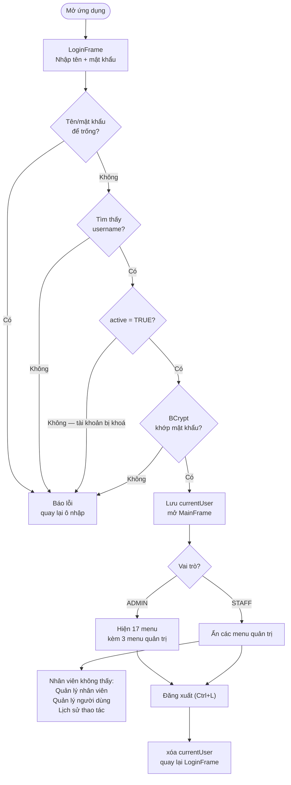

**Cơ chế kiểm tra:**

| Bước | Nơi kiểm tra | Hành vi khi sai |
|------|---------------|-----------------|
| Ô trống | `AuthService.login()` | `Optional.empty()` |
| Không tồn tại user | `userDAO.findByUsername()` | `Optional.empty()` |
| Tài khoản bị khoá | `u.getActive()` | Từ chối đăng nhập |
| Sai mật khẩu | BCrypt `checkpw()` | `Optional.empty()` |

> Phân quyền không phải kiểm tra từng thao tác mà thực hiện **một lần lúc dựng menu** (`MainFrame.initMenu()`), dựa trên `AuthService.isAdmin()`. Menu không được tạo thì không thao tác được.

---

## 2. Nhập kho — làm tăng tồn

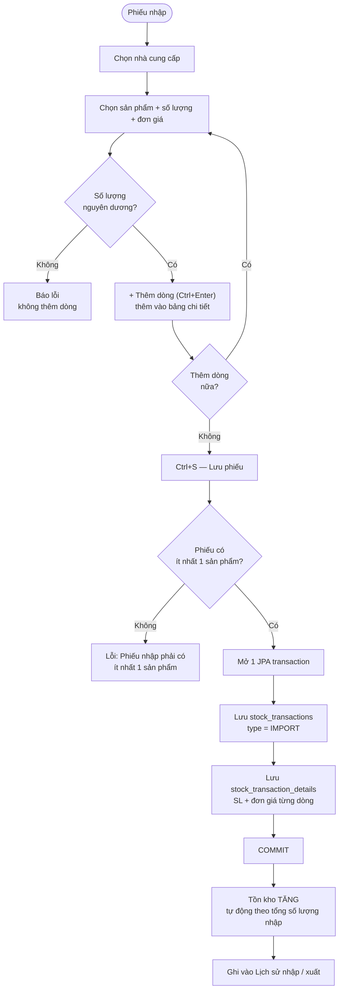

> **Nhập kho không cần kiểm tra tồn** — hàng vào kho luôn được chấp nhận.

---

## 3. Xuất kho — làm giảm tồn (luồng có kiểm soát nghiêm nhất)

Luồng này có **hai lớp chặn**: chặn ngay khi thêm dòng (trên UI) và chặn lúc lưu (trong service).

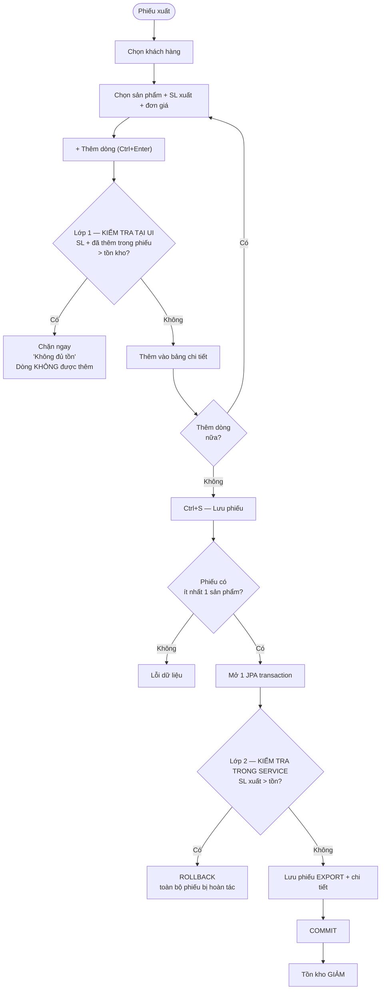

**Vì sao phải có hai lớp:**

| Lớp | Vị trí | Bắt trường hợp |
|-----|--------|---------------|
| 1 | `ExportPanel.addLine()` | Chặn sớm, báo rõ số tồn còn lại và số đã thêm trong phiếu |
| 2 | `StockService.createExport()` | Chặn từ xa — dữ liệu có thể đã thay đổi giữa lúc thêm dòng và lúc bấm Lưu |

> Lớp 2 là lớp **bảo vệ dữ liệu**: hai người dùng có thể cùng xuất một món hàng, và tồn thay đổi giữa lúc mở form và lúc bấm Lưu.

---

## 4. Công thức tính tồn kho

Tồn **không được lưu** trong database — luôn tính động từ lịch sử giao dịch:

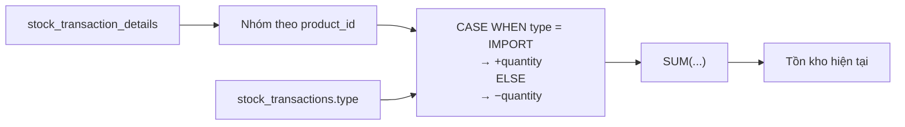

```sql
Tồn hiện tại = SUM(CASE WHEN type = 'IMPORT'
                        THEN quantity
                        ELSE -quantity END)
```

Điểm cần hiểu: đổi một phiếu cũ sẽ **lập tức làm thay đổi** tồn kho của tất cả báo cáo, vì không có con số nào được "đóng băng".

---

## 5. Đơn đặt hàng (PO) — từ đặt hàng đến nhận kho

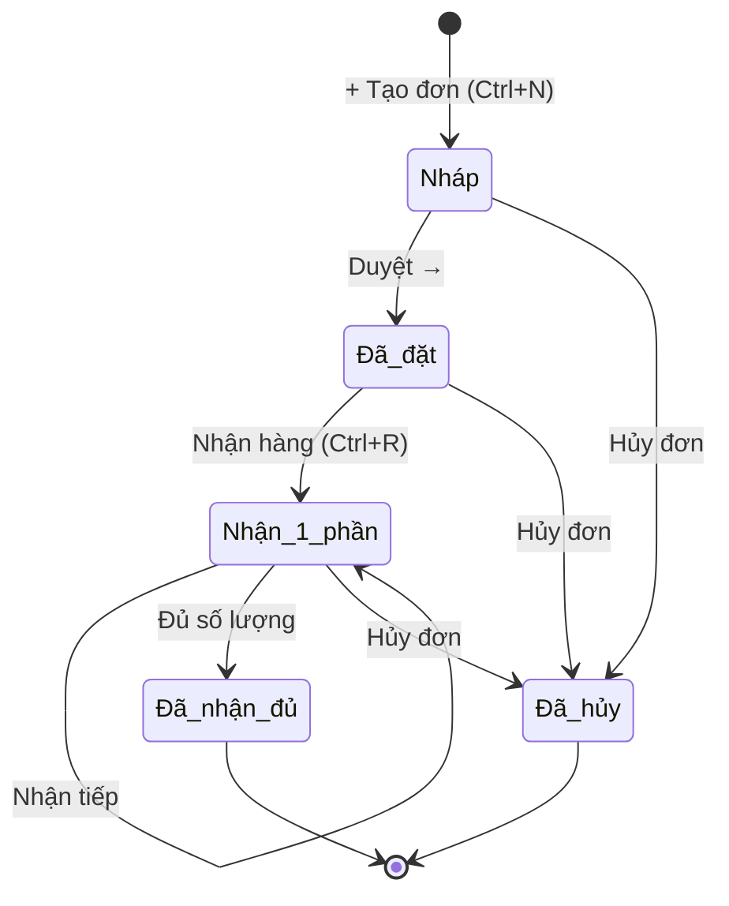

**Luồng "Nhận hàng" kết nối PO với kho:**

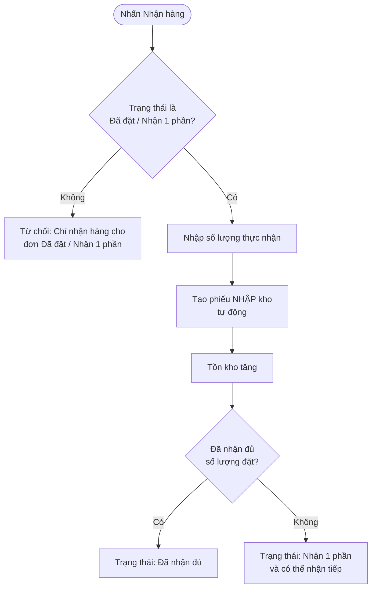

> PO là **ý định mua hàng** (hàng chưa về), phiếu nhập là **hàng đã thực sự về kho**. Bấm "Nhận hàng" là cầu nối giữa hai khái niệm này.

---

## 6. Hoá đơn bán hàng và thu tiền

Tạo hoá đơn ghi **cả phiếu xuất lẫn hoá đơn trong một transaction** — nên không thể xuất hàng mà không phát sinh tài chính.

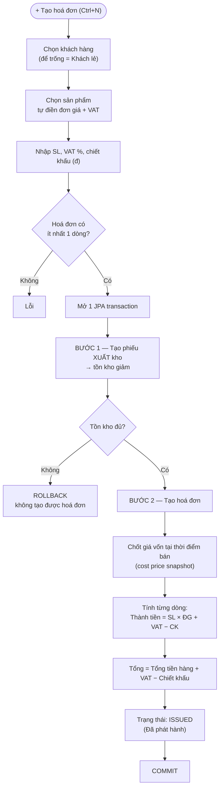

**Vì sao phải chốt giá vốn riêng?** Vì giá vốn của sản phẩm có thể thay đổi sau này, nhưng lợi nhuận của hoá đơn đã phát hành phải giữ nguyên đúng như ngày bán.

**Vòng đời thanh toán:**

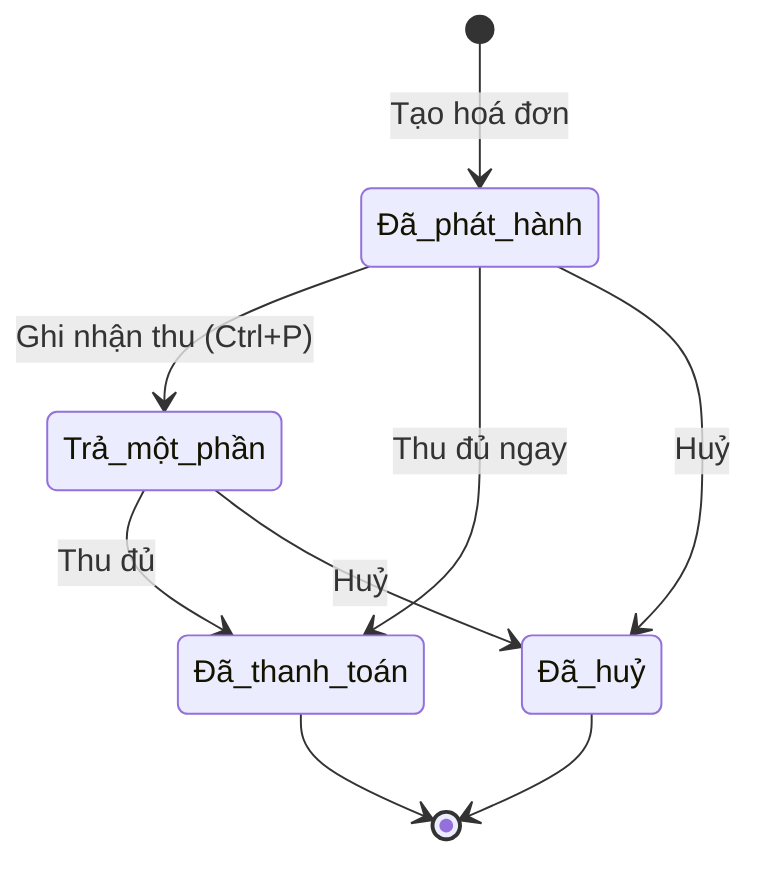

**Kiểm tra khi ghi nhận thu tiền:**

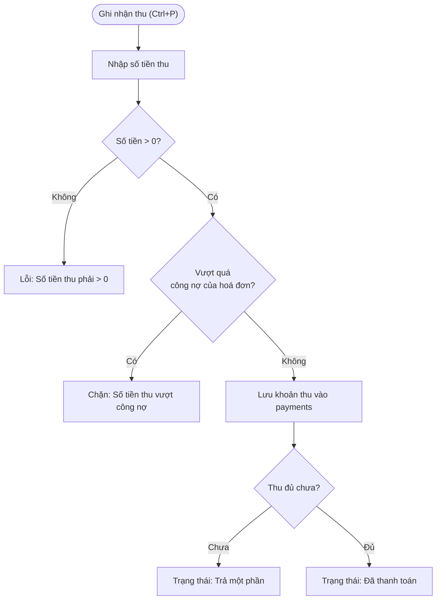

---

## 7. Báo cáo và công nợ

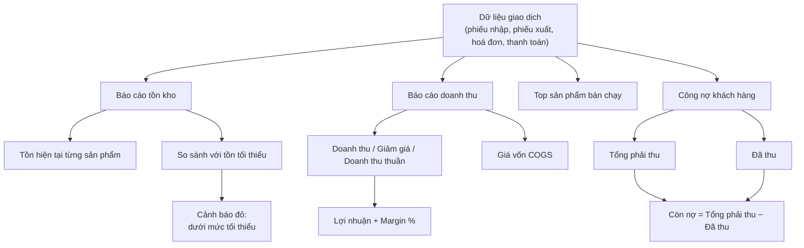

> Mọi báo cáo đều **tính lại từ dữ liệu gốc** mỗi khi mở, nên luôn khớp với lịch sử giao dịch — không có trường hợp báo cáo lệch với thực tế do dữ liệu bị "đóng băng" sai.

---

## 8. Xoá và khoá dữ liệu — vì sao phần mềm hay "từ chối xoá"

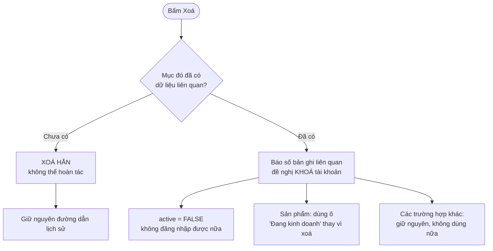

**Nguyên tắc:** dữ liệu lịch sử không được xoá, vì mọi báo cáo đều dựa vào nó. Bảng `stock_transactions` có `FOREIGN KEY (user_id)` không kèm `ON DELETE`, nên MySQL sẽ **từ chối** xoá một tài khoản đã từng phát sinh giao dịch — đây là ràng buộc bảo vệ dữ liệu ở tầng database, không phải giới hạn của giao diện.

**Hai chốt an toàn không thể vô hiệu hoá:**

- Không xoá/khoá được **tài khoản đang đăng nhập**.
- Phải còn **ít nhất 1 ADMIN đang hoạt động** — tránh tự khoá quyền quản trị khỏi hệ thống.

---

## 9. Bản đồ tổng thể các luồng

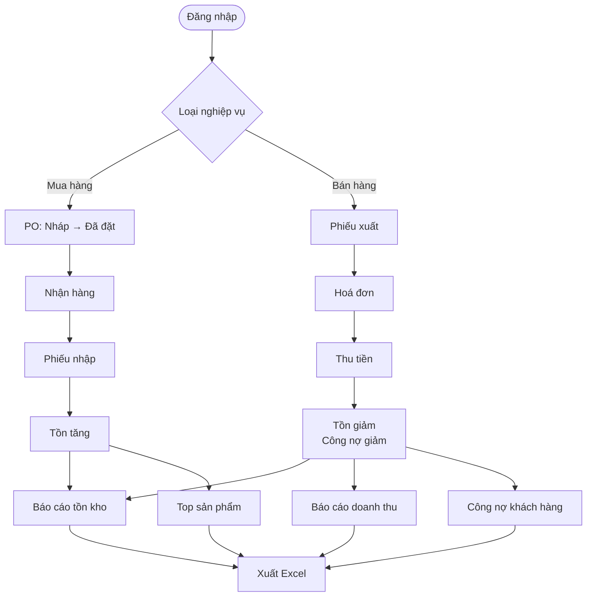

---

## Xem thêm

| Tài liệu | Nội dung |
|----------|----------|
| [`HUONG-DAN-SU-DUNG.md`](HUONG-DAN-SU-DUNG.md) | Hướng dẫn thao tác từng màn hình cho người dùng cuối |
| [`HUONG-DAN-CAI-DAT.md`](HUONG-DAN-CAI-DAT.md) | Cài đặt, cấu hình database, khắc phục sự cố |
| [`../README.md`](../README.md) | Kiến trúc, schema, quy tắc nghiệp vụ |

---

## Về thuật ngữ trong sơ đồ

| Từ trong sơ đồ | Nghĩa là gì |
|----------------|-------------|
| `IMPORT` / `EXPORT` | Loại giao dịch: nhập kho / xuất kho |
| `COMMIT` / `ROLLBACK` | Ghi nhận / hoàn tác thay đổi trong database |
| `ISSUED` / `PARTIAL` / `PAID` / `CANCELLED` | Trạng thái hoá đơn: đã phát hành / trả một phần / đã thanh toán / đã huỷ |
| `JPA transaction` | Đơn vị xử lý giao dịch database — mọi thao tác ghi đều nằm trong một transaction, lỗi thì tự động rollback |
| `COGS` | Giá vốn hàng bán (Cost of Goods Sold) |
| `Margin %` | Biên lợi nhuận = Lợi nhuận ÷ Doanh thu thuần × 100 |